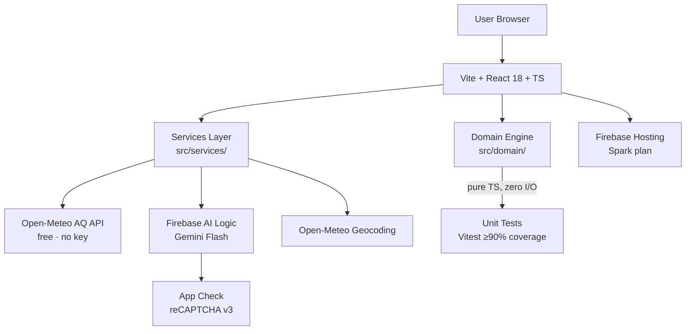

# Saans — Breathe Easy 🌿

> **Your personal air quality assistant for smog season.**  
> Built for TinkerHub Challenge 6 — GenAI for Real World Impact.

---

## The Problem

Winter smog in South Asian cities (Delhi, Lucknow, Lahore, Kolkata) routinely reaches AQI 400+. Families with children, elderly members, or respiratory conditions face elevated risks but lack **personalised, actionable, evidence-based guidance** at their fingertips.

## The Solution

**Saans** (Hindi for *breath*) is a progressive web app that:

1. Fetches **live AQI + 48-hour forecast** for your city (free, no API key needed)
2. Builds a **household risk profile** (sensitivities, home type, commute, cooking fuel, budget)
3. Generates a **time-blocked daily routine** optimised for the air quality forecast
4. Ranks **indoor air hacks** and **sustainable alternatives** by impact × feasibility
5. Shows **before/after exposure estimates** with community projection
6. Provides a **streaming AI chat** grounded on your context via Google Gemini
7. Produces a **printable community advisory** for schools, RWAs, and workplaces
8. Works in **English and Hindi**
9. **Never goes blank** — deterministic fallbacks when AI or the AQI API fails

---

## Architecture



| Layer | Purpose |
|---|---|
| `src/domain/` | Pure TS engine — no I/O, fully testable |
| `src/services/` | Typed, abortable I/O wrappers with Zod validation |
| `src/features/` | React feature modules (each owns its own UI) |
| `src/components/` | Design-system primitives |
| `src/config/` | Named constants, Firebase init, typed env |
| `src/i18n/` | English + Hindi translations |
| `src/hooks/` | Reusable React hooks (AQI, geocoding, Gemini, profile) |

---

## Requirement → Feature Map

| Requirement | Feature |
|---|---|
| Live AQI | Dashboard (AqiHeroCard, PollutantBreakdown, HourlyChart) |
| Household profile | Onboarding (3-step, skippable, localStorage) |
| Personalised routine | Plan (time-blocked, Gemini-enhanced) |
| Indoor hacks | IndoorHacks (ranked by impact/cost/effort) |
| Sustainable alternatives | Alternatives (personal + emissions benefit) |
| Impact explainer | ImpactExplainer (before/after, community projection) |
| AI chat | ChatPanel (streaming, suggested questions) |
| Community advisory | CommunityKit (printable) |
| Fallback | All features work without Gemini via deterministic engine |
| Privacy | Only approximate location sent to AI; profile stays local |

---

## How Gemini Is Used

Gemini is integrated via **Firebase AI Logic** (`firebase/ai`, `GoogleAIBackend`) — free-tier, Spark-plan compatible.

| Use | Details |
|---|---|
| `generatePlan()` | Low-temperature JSON output with `responseSchema`; validated with Zod; retries once; falls back to deterministic engine |
| `chat()` | Streaming via async generator; system instruction + XML-delimited context block; trimmed history |
| Guardrails | No diagnosis; urges medical help for severe symptoms; delimited user input (prompt-injection resistant); capped input/output |
| Privacy | Only city name, rounded coordinates (2dp), and anonymous profile flags sent; never names or exact GPS |

Prompts live in `src/services/gemini/prompts.ts`, versioned with `PROMPT_VERSION`.

---

## Impact Model

All numbers are **estimated ranges** drawn from:
- WHO Air Quality Guidelines 2021
- US EPA AQI breakpoints and guidance
- CPCB India data on urban pollutant sources

See [`docs/IMPACT_MODEL.md`](docs/IMPACT_MODEL.md) for full methodology, citations, and limitations.

> ⚠️ Gemini never invents numeric claims. It only explains numbers the deterministic engine supplies.

---

## Security

- **Firebase App Check** (reCAPTCHA v3 + debug token for localhost)
- **CSP headers** in `firebase.json` — no inline scripts, `frame-ancestors 'none'`
- **No secrets in repo** — only `VITE_*` public Firebase config; `.env.example` committed
- **Zod validation** on all API responses
- **Input sanitisation** on all user text before it reaches Gemini
- No `dangerouslySetInnerHTML` anywhere

See [`SECURITY.md`](SECURITY.md) for the full policy.

---

## Accessibility

WCAG 2.2 AA compliant:
- Skip link, single `<h1>`, semantic landmarks
- All form controls have accessible labels
- `aria-live` on plan updates and chat stream
- Full keyboard navigation, visible focus rings
- 44px minimum touch targets
- Colour + icon + pattern for AQI categories (never colour alone)
- `prefers-reduced-motion` respected (all transitions disabled)
- Chart has data-table alternative toggle
- `lang` attribute set dynamically on language switch

---

## Testing

```bash
npm test          # run all tests (offline)
npm run coverage  # coverage report
```

Coverage targets: **≥ 90% on `src/domain/`**

| Test suite | Location |
|---|---|
| Domain engine | `tests/domain/` (6 files) |
| Services (mocked fetch) | `tests/services/` (2 files) |
| Component unit tests | `tests/components/` (2 files) |
| Accessibility (axe) | `tests/a11y/axe.test.tsx` |

---

## Setup & Development

### Prerequisites
- Node.js 22+
- A Firebase project (Spark plan)
- Google Gemini API enabled in Firebase AI Logic

### Environment Variables

Copy `.env.example` to `.env.local` and fill in your Firebase config:

```bash
cp .env.example .env.local
```

```env
VITE_FIREBASE_API_KEY=...
VITE_FIREBASE_AUTH_DOMAIN=...
VITE_FIREBASE_PROJECT_ID=...
VITE_FIREBASE_STORAGE_BUCKET=...
VITE_FIREBASE_MESSAGING_SENDER_ID=...
VITE_FIREBASE_APP_ID=...
VITE_APP_CHECK_RECAPTCHA_KEY=...
```

### Local Development

```bash
npm install
npm run dev
```

### Deployment

```bash
npm run build
firebase deploy --only hosting
```

The app deploys to Firebase Hosting (Spark plan). No Cloud Functions required.

---

## Assumptions & Limitations

- Air quality data from Open-Meteo may lag real-time conditions by 1–3 hours
- AQI displayed is US AQI standard (not India NAQI)
- Exposure reduction estimates are ranges; individual results vary
- Gemini responses are grounded on the domain engine's numbers, not independent medical advice
- Free-tier Gemini prompts may be used by Google to improve their products (disclosed in-app)

---

## Medical Disclaimer

Saans provides **informational guidance only**. It is not a substitute for professional medical advice, diagnosis, or treatment. If you experience breathing difficulties, chest pain, or other severe symptoms, seek medical attention immediately. **Dial 112** (India) in an emergency.

---

## Data Attributions

- **Air quality data**: [Open-Meteo](https://open-meteo.com/) — free, open-source, no API key required
- **Geocoding**: [Open-Meteo Geocoding API](https://open-meteo.com/en/docs/geocoding-api)
- **AI**: Powered by [Google Gemini](https://gemini.google.com/) via [Firebase AI Logic](https://firebase.google.com/docs/ai-logic)
- **Impact model citations**: WHO 2021, US EPA, CPCB — see `docs/IMPACT_MODEL.md`
