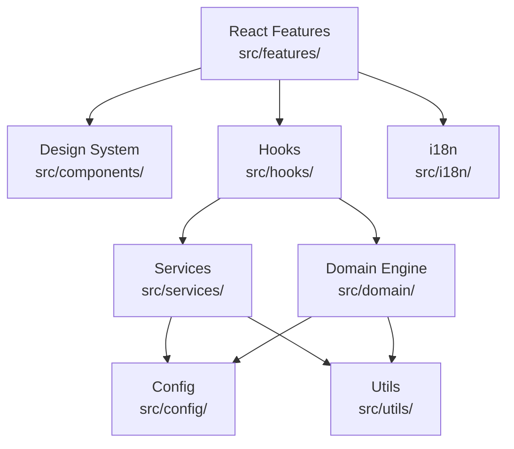
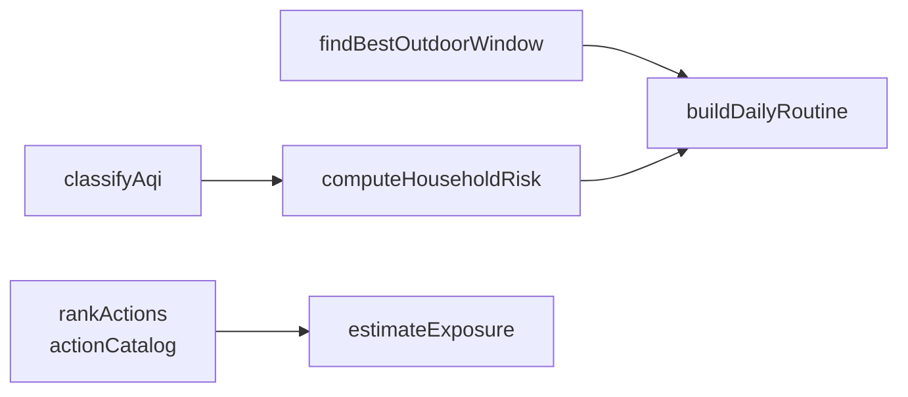
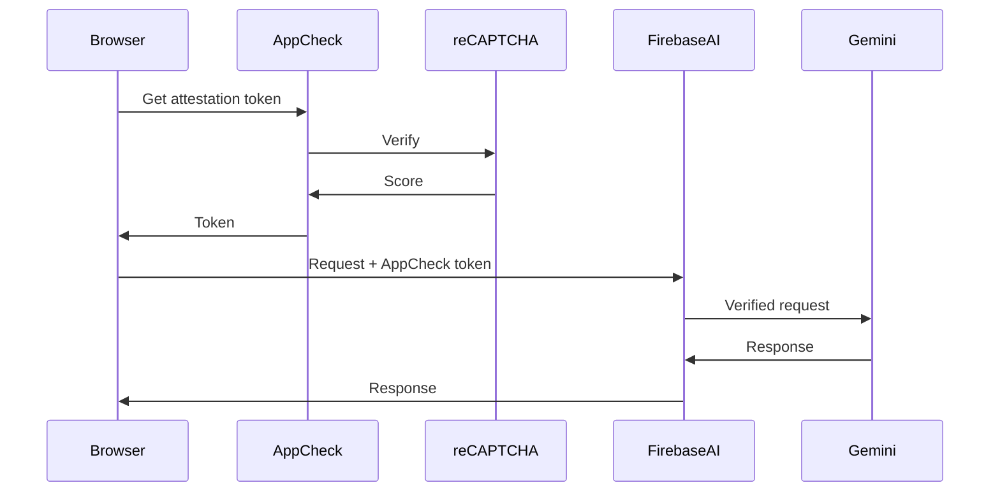

# Architecture

## Overview

Saans follows a strict layered architecture to ensure testability, maintainability, and clear separation of concerns.



## Layer Rules

| Layer | Rule |
|---|---|
| `src/domain/` | **Zero I/O.** Pure TypeScript functions only. No fetch, no React, no localStorage. |
| `src/services/` | All I/O here. Each service is abortable via AbortController and returns `Result<T>`. |
| `src/hooks/` | React-only glue between services/domain and features. |
| `src/features/` | No business logic. Only orchestrates hooks and renders components. |
| `src/components/` | Stateless design-system primitives only. |

## Domain Engine (`src/domain/`)

The domain engine is the heart of Saans. It is 100% pure TypeScript with no I/O, making it trivially testable.



| Function | Purpose |
|---|---|
| `classifyAqi(value)` | EPA AQI → category, label, CSS class, icon |
| `computeHouseholdRisk(profile, aqi)` | Composite risk score with sensitivity/home/cooking multipliers |
| `findBestOutdoorWindow(hourly)` | Sliding-window search for safest 2–6 hour block |
| `buildDailyRoutine(profile, hourly, risk)` | 6 time-blocked activities for the day |
| `rankActions(catalog, profile, aqi)` | score = relevance×0.3 + impact×0.5 + feasibility×0.2 |
| `estimateExposure(aqi, actions)` | Diminishing-returns reduction model, 70% cap |

## Services (`src/services/`)

### Air Quality (`airQuality/`)

- Endpoint: `https://air-quality-api.open-meteo.com/v1/air-quality`
- Parameters: `us_aqi,pm2_5,pm10,nitrogen_dioxide,ozone,sulphur_dioxide,carbon_monoxide`
- Cache: 15-minute TTL in memory + sessionStorage
- Validation: Zod schema on response

### Geocoding (`geocoding/`)

- Endpoint: `https://geocoding-api.open-meteo.com/v1/search`
- Debounced at 300ms in the hook
- Validation: Zod schema on response

### Gemini (`gemini/`)

- SDK: `firebase/ai` with `GoogleAIBackend`
- Model: `gemini-3.8-flash` primary, `gemini-3.5-flash-lite` fallback
- `generatePlan`: JSON mode, `responseSchema`, Zod validation, one retry, deterministic fallback
- `chat`: Async generator streaming, AbortController support
- Prompts: Versioned in `prompts.ts`, XML-delimited context blocks

## State Management

Saans uses **React hooks only** — no Redux, no Zustand, no Context API (beyond Router). State lives as close to its usage as possible.

| State | Location |
|---|---|
| Location + profile | `useProfile` → localStorage |
| AQI data | `useAirQuality` → component-level, cached by service |
| Gemini plan | `useGemini` → component-level |
| Language | `useTranslation` → localStorage |

## Code Splitting

```typescript
// All routes are lazy-loaded
const Dashboard = lazy(() => import('@/features/dashboard'));
const ChatPanel = lazy(() => import('@/features/chat'));
// ...
```

Vite manual chunks: `firebase` and `vendor` are split to separate bundles.

## Security Architecture


